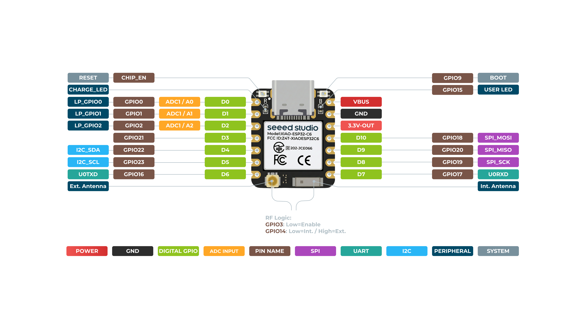

# XIAO ESP32-C6 — 8 wejść i 24 endpointy Zigbee

Wersja **2.3.1** dla Seeed Studio XIAO ESP32-C6 ze stałym zasilaniem USB i
anteną zewnętrzną U.FL albo wewnętrzną (osobne obrazy firmware’u). Urządzenie pracuje jako router Zigbee, bez usypiania
i bez heartbeat. Każdy z 24 endpointów ma własną konfigurację, bindingi i binding_priority.
Osiem wejść fizycznych można przypisywać do endpointów niezależnie.

[Kod źródłowy](https://github.com/direk/xiao-esp32-c6-8ch-zigbee-switch).
[Wydanie 2.3.1 — firmware, konwerter i kompletna paczka](https://github.com/direk/xiao-esp32-c6-8ch-zigbee-switch/releases/tag/v2.3.1).
Skrypt pakujący generuje również lokalne `dist/xiao-8ch-v2.3.1.zip`.
[Wydanie 1.2.0 na GitHubie](https://github.com/direk/xiao-esp32-c6-8ch-zigbee-switch/releases/tag/v1.2.0)
jest starszą wersją czterokanałową.

## Zmiany w 2.3.1

Naprawia timeout Z2M przy zmianie `input_gesture` i innych ustawień. SDK
wywołuje write hook także podczas lokalnej synchronizacji atrybutów; wcześniej
powodowało to ponowne wejście w zapis i rekurencję. Nowy guard obejmuje całą
operację, nie pozwala zagnieżdżonym aktualizacjom nadpisać konfiguracji i zostaje
zwolniony przed kolejnym zewnętrznym zapisem. Parametry, mapy i NVS nie zmieniają
formatu. Samą poprawkę firmware’u obsługuje także konwerter **0.1.0**. Konwerter **0.1.2** dodatkowo ukrywa nieużywane pola konfiguracji endpointów.
Obrazy `xiao-8ch-v2.3.1-{external,internal}.zigbee` mają wersję OTA
0x02030100. Wydanie zawiera firmware dla obu anten i konwerter 0.1.2;
po jego podmianie zrestartuj Z2M i wykonaj **Reconfigure**.
Szczegółowe zasady numeracji żądań UART/USB `@ID` opisano poniżej.

## Podłączenie

Każdy przycisk lub przełącznik podłącz między swoim pinem a **GND**.
Wejścia mają wewnętrzne podciąganie do 3,3 V i debounce 35 ms.
Do GPIO wolno podłączać wyłącznie styki bezpotencjałowe, nigdy 230 V.

| Wejście (domyślny endpoint legacy) | Pin XIAO | GPIO |
|---|---|---|
| CH1 / 1 | D0 | 0 |
| CH2 / 2 | D1 | 1 |
| CH3 / 3 | D2 | 2 |
| CH4 / 4 | D3 | 21 |
| CH5 / 5 | D4 | 22 |
| CH6 / 6 | D5 | 23 |
| CH7 / 7 | D8 | 19 |
| CH8 / 8 | D9 | 20 |



Schemat oznaczeń płytki; przypisanie kanałów CH1–CH8 podaje tabela powyżej.

D6/TX (GPIO16) i D7/RX (GPIO17) obsługują komendy UART 3,3 V:
115200 baud, 8N1, bez kontroli przepływu. D10 (GPIO18) pozostaje wolny. CH7/CH8 zajmują D8/D9, więc te piny nie są dostępne dla SPI.
Przy aktualizacji poprzedniej wersji 8CH przenieś przewód CH7 z D6 na D8,
a CH8 z D7 na D9. Numery kanałów, ustawienia i bindingi pozostają te same.
Te same komendy są dostępne przez USB-C (USB Serial/JTAG, GPIO12/13). GPIO3=LOW włącza przełącznik antenowy; GPIO14=HIGH wybiera
antenę zewnętrzną, GPIO14=LOW wewnętrzną; **D3 to GPIO21**, niezależny od GPIO3.

## Przyciski przez UART i USB-C

Urządzenie zewnętrzne może symulować CH1–CH8 przez `PRESS`, `RELEASE`,
`CLICK`, `DOUBLE`, `TRIPLE`, `HOLD` oraz `SET` dla rocker. Komendy są tekstowe,
kończone LF; np. `CLICK 2\n` symuluje kliknięcie CH2. Obowiązują te same
tryby i binding priority co dla fizycznych przycisków. UART i USB-C mają
osobne zadania FreeRTOS i niezależne sesje identyfikatorów; komendy trafiają do Zigbee przez ograniczoną
kolejkę, bez czekania na porty w obsłudze Zigbee. Odpowiedź wraca na port
żądania. Pełna kolejka USB nie blokuje UART.
`GET 2\n` zwraca jedną linię JSON z pełną konfiguracją CH2, dozwolonymi
komendami UART (`commands`) i gestami dającymi efekt (`gestures`). Odczyt
nie zmienia kanału i działa również przed gotowością sieci Zigbee.

W protokole UART v2 `INFO` zwraca wersję firmware’u/protokołu i numer uruchomienia,
a `STATUS` stan sieci, bindingi, wejścia i liczniki błędów. Opcjonalne rosnące
identyfikatory (np. `@42 CLICK 2`) chronią przed ponownym wykonaniem przy utracie
odpowiedzi. Błędy odbioru UART odrzucają uszkodzoną linię do następnego LF.
`RESET` kasuje dane sieci Zigbee i bindingi, zachowuje ustawienia kanałów i
restartuje urządzenie, które automatycznie rozpoczyna parowanie. W Z2M trzeba
włączyć Permit join. Zwykłe komendy UART z 2.0.0 nadal działają bez zmian.
`LOG 0` wyłącza, a `LOG 1` włącza logi tylko na porcie, z którego wysłano
komendę. Domyślnie oba porty mają logi wyłączone; po restarcie znów są wyłączone.
Logi mają prefiks `#LOG `, a INFO/STATUS pokazują port i `logs_enabled`.
Konwerter Z2M z wydania 2.0.0 pozostaje zgodny; klaster ustawień nie zmienił się.
Od 2.2.0 dostępne jest [OTA przez Zigbee2MQTT](docs/OTA.md). Pierwsza migracja
z 2.1.x wymaga USB i nowej tablicy partycji, z zachowaniem danych sieci.
[Historia zmian](CHANGELOG.md) · [Zakres wykonanych testów](docs/VALIDATION.md).

Podłącz TX urządzenia do D7/RX, RX do D6/TX i wspólną masę.
Prawdziwy RS-232 wymaga konwertera poziomów (np. MAX3232); nie podłączaj go
bezpośrednio do GPIO. [Pełny opis protokołu i odpowiedzi](docs/UART.md).


### Opcjonalny numer komendy `@ID` — zasady i ponawianie

`@ID` to identyfikator **żądania**, a nie numer kanału, endpointu czy sceny.
Jest opcjonalny: `CLICK EP2` działa bez niego. Warto go używać, gdy urządzenie
sterujące czeka na odpowiedź i ponawia komendę po jej utracie.

Przykład dla endpointu skonfigurowanego tak, aby kliknięcie dawało efekt
(każda linia wysłana i odebrana kończy się LF, czyli `\n`):

```text
ESP32 → XIAO: @42 CLICK EP2
XIAO → ESP32: @42 OK CLICK EP2
```

Jeżeli odpowiedź zaginie, ESP32 wysyła ponownie `@42 CLICK EP2`.
XIAO zwraca zapamiętane `@42 OK CLICK EP2`, **bez drugiego kliknięcia**.
Następne, zamierzone kliknięcie ma nowy numer: `@43 CLICK EP2`.
To chroni np. przed podwójnym Toggle, które zapaliłoby i natychmiast zgasiło lampę.

1. **Nowe żądanie → nowy, większy numer.** Dopuszczalne są liczby dziesiętne
   `1..4294967295`, bez zawijania licznika w tym samym uruchomieniu XIAO.
   Licznik jest wspólny dla wszystkich kanałów i komend na danym porcie,
   nie osobny dla każdego endpointu. Luki w numeracji są dozwolone.
2. **Brak odpowiedzi → ten sam numer i ta sama komenda.** Zwiększenie numeru
   przy ponowieniu traktowane jest jako nowe żądanie i może wykonać akcję ponownie.
   Dopasuj odpowiedź po prefiksie `@ID`. Zalecamy jedno oczekujące żądanie naraz,
   ograniczoną liczbę ponowień i pomijanie linii `#LOG `, jeśli włączono logi.
3. **Ostatnie 16 odpowiedzi jest pamiętane.** Wpis może zawierać także błąd,
   np. `ERR NOT_READY`. Powtórzenie tego samego ID zwróci wtedy ten sam błąd,
   nawet gdy sieć jest już gotowa. Po usunięciu przyczyny błędu wyślij nowe
   żądanie z nowym ID. `INFO`, `STATUS` i inne numerowane żądania również
   zajmują miejsce w historii; zwykłe komendy bez ID nie zajmują go.
4. **Ten sam ID z inną komendą → `ERR ID_CONFLICT`.** Przykładowo po
   `@42 CLICK EP2` nie wolno wysłać `@42 CLICK EP3` ani `@42 CLICK 2`.
   `CLICK 2` oznacza wejście fizyczne, a `CLICK EP2` endpoint logiczny.
5. **Stary ID poza historią → `ERR ID_EXPIRED`.** XIAO nie wykonuje go ponownie.
   Nie zamieniaj automatycznie takiego żądania na nowe ID: poprzednia akcja
   mogła już nastąpić. Najpierw rozstrzygnij wynik lub zgłoś niepewność.
6. **Restart XIAO zeruje historię.** Przed rozpoczęciem komunikacji wyślij
   zwykłe `INFO` i odczytaj `boot_id`; kontroluj go również po przerwie
   w komunikacji. Gdy zmieni się `boot_id`, można rozpocząć numerację od 1,
   ale nie ponawiaj automatycznie niepotwierdzonych akcji z poprzedniego
   uruchomienia — XIAO nie pamięta już, czy je wykonało.
7. **Restart sterującego ESP32 nie zeruje historii XIAO.** Zachowuj na ESP32
   numerację i oczekujące żądanie wraz z `boot_id` oraz portem przed wysłaniem.
   Jeśli XIAO nadal ma ten sam `boot_id`, kontynuuj tę sesję. Nie zaczynaj
   automatycznie od 1 i nie twórz nowego żądania w miejsce starego o nieznanym
   wyniku. Utrata lokalnej historii wymaga świadomego odzyskania synchronizacji.
8. **UART i USB mają niezależne sesje.** Powtórzenie komendy na drugim porcie
   nie jest deduplikowane względem pierwszego. Wszystkie urządzenia nadające
   na jednym porcie muszą współdzielić jeden licznik.

`OK` potwierdza przyjęcie/obsłużenie komendy przez XIAO. **Nie potwierdza
reakcji lampy ani dostarczenia polecenia Zigbee.** Gest może też nie dawać
żadnej akcji przy danej konfiguracji — sprawdź `GET EP2`.
Ochrona `@ID` dotyczy ponownego wykonania żądania w bieżącej sesji XIAO;
nie zapewnia jednokrotnego efektu na lampie przez restarty i utratę zasilania.
Błędy parsera lub przepełnienia kolejki mogą nie mieć prefiksu `@ID`;
nie traktuj ich jako numerowanego potwierdzenia innej komendy.


## Ustawienia kanału

- `input_mode`: `push` dla przycisku chwilowego, `rocker` dla przełącznika
  dwupozycyjnego. `rocker + toggle` wysyła Toggle przy każdej zmianie styku
  (zwarcie i rozwarcie), niezależnie od stanu lampy ustawionego przez inne
  automatyzacje. `rocker + momentary` daje ON przy zwarciu i OFF przy rozwarciu.
  Pozostałe funkcje wymagają `push`.
- `invert`: odwraca aktywny poziom wejścia.
- `binding_priority`: `ON` (domyślnie) pomija `action`, gdy polecenie idzie
  przez binding. `OFF` zachowuje sterowanie przez binding i dodatkowo wysyła
  `action`. Opcja jest niezależna dla CH1–CH24 i zapisywana na urządzeniu.
  Bez pasującego bindingu kanał zawsze wysyła `action`.
- `switch_type`: funkcja z tabeli poniżej, osobna dla każdego kanału.
- `switch_actions`: `off`, `on`, `toggle` lub `on_off` dla wejścia push w funkcjach
  `toggle` i `momentary`. Domyślnie `toggle`.
  Nowe `on_off` (od testowej wersji 2.2.1; wymaga konwertera 0.0.8) wysyła jawne ON/OFF zamiast komendy Toggle.
  Dla `push + toggle` kolejne naciśnięcia wysyłają ON, OFF, ON, OFF.
  Dzięki temu grupa żarówek o mieszanych stanach otrzymuje tę samą komendę.
  Każdy kanał ma osobną kolejność, wspólną dla przycisku i komend UART/USB.
  Dla `push + momentary` kolejność ON/OFF zmienia się zarówno przy naciśnięciu, jak i puszczeniu.
  `rocker` i funkcje zaawansowane ignorują `switch_actions`.
  Od konwertera **0.1.1** Z2M pokazuje to pole tylko dla `push` z typem
  `toggle` lub `momentary`, niezależnie dla każdego z 24 endpointów.
  Po potwierdzeniu zmiany konfiguracji pole automatycznie znika albo wraca;
  jego zapisana wartość pozostaje bez zmian. Przed pierwszym odczytem konfiguracji
  pole może być widoczne. Po podmianie konwertera zrestartuj Z2M i wykonaj
  **Reconfigure**, aby odczytać aktualne ustawienia wszystkich endpointów.
  Nie wymaga to nowego firmware’u ani ponownego parowania.

  Ustawienie jest trwałe; kolejność jest w RAM, bez zapisu pamięci przy każdym kliknięciu.
  Po restarcie lub zapisie `switch_actions` zaczyna się od ON; inne ustawienia zachowują kolejność.
  Zewnętrzne automatyzacje i stan żarówek nie zmieniają kolejności: jeśli następne jest ON,
  a światło już świeci, kliknięcie nie zmieni go wizualnie.
  Przy wysyłaniu `action` otrzymasz odpowiednio `chN_on` i `chN_off`.
- `min_level`, `max_level`: zakres jasności 1–254, domyślnie 1 i 254.
- `transition_time`: czas przejścia w 0,1 s, domyślnie 25 (2,5 s), zakres 0–600.
- `color_temp_min`, `color_temp_max`: granice temperatury w miredach,
  domyślnie 153 i 500; dopasuj do możliwości lampy.
- `scene_id`, `group_id`: numer sceny i grupy dla funkcji `scene`.

Od konwertera **0.1.2** pozostałe parametry również pojawiają się
według `switch_type`, osobno dla każdego z 24 endpointów:

| Pole | Widoczne dla |
|---|---|
| `switch_actions` | `push` + `toggle` lub `momentary` |
| `min_level`, `max_level` | `brightness_level`, `brightness_level_up`, `brightness_level_down` i ich warianty `*_no_onoff` |
| `color_temp_min`, `color_temp_max` | `move_to_color_temperature`, `move_to_color_temperature_up`, `move_to_color_temperature_down` |
| `transition_time` | Wszystkie powyższe typy jasności i temperatury barwowej |
| `scene_id` | `scene` |
| `group_id` | `scene` lub `scene_cycle` |
| `scene_list` | `scene_cycle` |

`switch_type`, `input_source`, `input_gesture`, `input_mode`, `invert` oraz
`binding_priority` pozostają widoczne. Reguły nie zależą od wybranego gestu
ani obecności bindingu: endpoint można również wyzwalać przez UART/USB.
Z2M odświeża pola po potwierdzonym odczycie ustawień z urządzenia. Ukryte
wartości pozostają zapisane i wracają po ponownym wybraniu odpowiedniego typu;
ukrywanie nie blokuje bezpośrednich komend MQTT ani UART/USB.
Przed pierwszym odczytem nieznanego typu pola pozostają widoczne.
Po instalacji konwertera **0.1.2** zrestartuj Z2M i wykonaj **Reconfigure**.
To zmiana konwertera, bez potrzeby wgrywania firmware’u lub parowania.

Przed wybraniem zaawansowanej funkcji ustaw `input_mode=push`. Próba użycia jej
z wejściem rocker zostanie odrzucona. Przy zmianie granic min/max najpierw ustaw
tę granicę, która pozwoli zachować poprawny zakres. Zmiany zapisują się w NVS
po sekundzie od ostatniej zmiany; zmiana parametrów wejścia lub funkcji
zatrzymuje trwającą regulację. `binding_priority` działa od następnego polecenia
i nie przerywa przytrzymania. Po aktualizacji istniejące urządzenia mają tę
opcję `ON` na wszystkich kanałach; pozostałe ustawienia są zachowane.

## 24 endpointy i przypisywanie wejść — od 2.3.0

Model Zigbee pozostaje `XIAO-C6-8CH`. Konwerter **0.1.0** udostępnia
`ch1`–`ch24`, czyli endpointy EP1–EP24. To kanały logiczne; wejść fizycznych
pozostaje osiem. OTA i globalna diagnostyka nadal używają tylko EP1.
Po OTA podmień konwerter, zrestartuj Z2M i wykonaj **Interview oraz Reconfigure**.

Każdy endpoint ma własne `switch_type`, `switch_actions`, `scene_id`, `scene_list`,
`group_id`, zakresy, `binding_priority` oraz:

| Ustawienie | Wartości | Znaczenie |
|---|---|---|
| `input_source_chN` | none, D0, D1, D2, D3, D4, D5, D8, D9 | Fizyczne wejście lub tylko UART/USB |
| `input_gesture_chN` | legacy, single, double, hold | Sposób wyzwalania z fizycznego wejścia |

`legacy` zachowuje surowy styk i dotychczasowe tryby push/rocker, w tym czasy
500 ms w zaawansowanych funkcjach. `single`/`double` aktywuje endpoint **raz**,
jak pojedyncze wirtualne naciśnięcie przez 100 ms. `hold` aktywuje go na czas
przytrzymania, zaczynając regulację bez drugiego oczekiwania 500 ms po
rozpoznaniu gestu. Puszczenie kończy regulację komendą Stop z tego samego EP.
Działanie wynika z `switch_type` endpointu: np. toggle/on_off, scene/scene_cycle,
brightness_level. Nie jest to dodatkowa tabela działań gestów wewnątrz endpointu.

Dla jednego pinu nie wolno mieszać `legacy` z rozpoznawanymi gestami — zapis
zostanie odrzucony. Najpierw przełącz dotychczasowy endpoint na `single`,
a dopiero potem przypisz kolejne endpointy do `double` i `hold` tego pinu.
Wiele endpointów może reagować na ten sam pin i gest (każdy wykonuje własną akcję).
Rockery wymagają `legacy`; `single/double/hold` wymagają pin_mode=push.

Przykład: D1 steruje EP2/EP10/EP18. W panelu Z2M ustaw kolejno:

1. `pin_mode_d1=push`, `input_gesture_ch2=single`,
   `switch_type_ch2=toggle`, `switch_actions_ch2=on_off`.
2. EP10: `input_source_ch10=D1`, `input_gesture_ch10=double`,
   `switch_type_ch10=scene_cycle`, `group_id_ch10=10`, `scene_list_ch10=0,1,3`.
3. EP18: `input_source_ch18=D1`, `input_gesture_ch18=hold`,
   `switch_type_ch18=brightness_level` (lub brightness_level_no_onoff).
4. Zbinduj EP2/ch2 przez genOnOff do odpowiednich lamp, EP18/ch18 przez
   genLevelCtrl do grupy. EP10 ma bezpośredni cel grupowy ustawiony przez group_id.

Bez pasującego bindingu emitowane jest action **endpointu**, np. `ch18_brightness_move_up`.
Binding EP2 nie wpływa na raporty EP10/EP18. Binding priority jest osobne dla
każdego EP i dotyczy jego bindingu/bezpośredniej grupy. Dostępne są 456 akcje
(24 endpointy × 19), a tabela bindingów ma 96 wpisów łącznie dla wszystkich EP.

Ustawienia fizycznego pinu są wspólne i mają osobne pola bez sufiksów chN:
`pin_mode_d1`, `pin_invert_d1`, `pin_hold_time_d1` (250–5000 ms, domyślnie 500)
i `pin_multi_click_time_d1` (150–1000 ms, domyślnie 500). Analogiczne pola
są dla d0/d2/d3/d4/d5/d8/d9. Czasy dotyczą klasyfikatora single/double/hold.
`input_mode_chN` i `invert_chN` pozostają zgodnymi aliasami ustawień źródłowego
pinu, gdy endpoint ma przypisany pin; bez źródła dotyczą wirtualnego endpointu
(invert nie odwraca komend PRESS/RELEASE). Zmiana wspólnego parametru pinu
synchronizuje powiązane endpointy; odśwież ich pola w Z2M, jeśli panel pokazuje
starą wartość. Zmiana na rocker jest odrzucana, jeśli istnieje mapping decoded
lub powiązany tryb zaawansowany, który nie obsługuje rockera.

Pojedynczy klik czeka na zakończenie okna wielokliku **tylko gdy na tym pinie
istnieje odbiorca double**. Przy hold klik jest pomijany, a release nie wykonuje
kolejnej akcji. Przy startup/rebase z wciśniętym wejściem nie ma sztucznego gestu.
W trybach zaawansowanych wyzwolony logiczny klik może dodatkowo podlegać
istniejącemu rozpoznawaniu wielokliku endpointu (500 ms).

Migracja 2.2.x zachowuje konfiguracje i bindingi EP1–EP8. Ich źródła pozostają
D0–D5/D8/D9 z gesture=legacy. Nowe EP9–EP24 mają source=none, więc samo OTA
nie dodaje dodatkowych akcji. EP9–EP16 mają domyślnie gesture=double i toggle,
EP17–EP24 gesture=hold i brightness_level; trzeba przypisać im pin.
Konfiguracja 24 EP i pinów jest zapisana w NVS jako config3; starszy config2
pozostaje eksportem ustawień pierwszych ośmiu EP dla rollbacku. Starszy firmware
nie obsłuży nowych mappingów i endpointów. Restart nie zapisuje pozycji cykli
ani faz ON/OFF — pierwsza akcja po restarcie jest nadal pierwszą w sekwencji.

UART/USB: `CLICK 2` symuluje fizyczne D1 przez nową mapę; `CLICK EP10`
omija mapę i aktywuje bezpośrednio EP10. **DOUBLE EP10** to dwa logiczne
naciśnięcia EP10, więc w toggle wykona dwie akcje; nie jest odpowiednikiem
jednego fizycznego gestu double. `GET 2` pokazuje pin i przypisane endpointy,
`GET EP10` konfigurację endpointu, `STATUS EP10` jego bindingi/stany.
Protokół 3 zachowuje stare formy komend; szczegóły w [UART.md](docs/UART.md).

## Identify i diagnostyka

Podmień konwerter na **0.0.9**, zrestartuj Z2M, a po OTA wykonaj **Interview**
i **Reconfigure**. Nowy klaster Diagnostics musi zostać zapisany w deskryptorze
urządzenia w Z2M. Dostępne są wspólne opcje całej płytki (bez sufiksu kanału):

- `identify`: wybierz `identify`, aby migać diodą na **GPIO15**. Domyślny czas
  to 3 sekundy; opcja konwertera `identify_timeout` pozwala ustawić 1–30 s.
  LED jest aktywna stanem LOW, zmienia stan co 250 ms i gaśnie po zakończeniu.
  Standardowa komenda Identify z czasem 0 zatrzymuje identyfikację.
  Identify działa na każdym z ośmiu endpointów; wspólna LED miga, dopóki
  przynajmniej jeden endpoint ma aktywny IdentifyTime. Obsługa nie blokuje
  przycisków, UART/USB, Zigbee ani OTA.
- `number_of_resets`: standardowy atrybut klastra **Diagnostics 0x0B05** na EP1.
  Licznik jest trwały; pierwsze uruchomienie tej funkcji daje 0, kolejne rozruchy
  zwiększają go do maksymalnie 65535. To licznik od pierwszej instalacji tej
  funkcji, nie historia restartów sprzed aktualizacji. Restart zasilania też się liczy.
- `uptime`: sekundy od startu bieżącego programu.
- `reset_reason`: np. `power_on`, `software`, `panic`, `brownout`,
  `task_watchdog`, `usb` — przyczyna startu zgłoszona przez ESP-IDF.
- `zigbee_tx_request_errors`: liczba **lokalnie odrzuconych żądań APS** dla
  bezpośredniego sterowania od startu programu. Nie jest to liczba zgubionych
  pakietów, braków ACK ani żarówek, które nie wykonały komendy. Raporty action,
  ruch routera i OTA nie są wliczane. Sukces przyjęcia żądania nie dowodzi
  dostarczenia ani wykonania; przy grupie nie ma potwierdzenia każdej lampy.

Dodatkowe trzy pola są atrybutami naszego klastra 0xFC00 na EP1; nie podszywają
się pod standardowe liczniki MAC/APS. Odczyt działa przez przyciski odświeżania
w Z2M. Wartości są też raportowane po dołączeniu do sieci i co 60 sekund.
`uptime` odświeża się lokalnie co sekundę; licznik błędów po odrzuceniu żądania.
Licznik restartów jest zapisany w osobnej przestrzeni NVS `xiao_diag`, raz na
rozruch. Komenda RESET sieci i reset ustawień przyciskiem BOOT go zachowują;
pełne kasowanie pamięci flash go usuwa. Pozostałe liczniki są w RAM.

## Rotacja scen grupy

Każdy kanał ma własne pole tekstowe `scene_list` w Z2M. Przykład dla CH2:

```json
{"input_mode_ch2":"push","group_id_ch2":10,"scene_list_ch2":"0,1,3","switch_type_ch2":"scene_cycle"}
```

Ustaw najpierw `input_mode=push`, jeśli kanał był rocker. W Z2M wybierz
`switch_type=scene_cycle`, `group_id` wybranej grupy i wpisz `scene_list`.
Kliknięcia przywołują sceny **0 → 1 → 3 → 0**. Są to ID scen, nie nazwy;
ID 0 jest poprawne. Kolejność jest dokładnie taka jak w polu tekstowym.
Lista mieści do 16 różnych ID od 0 do 255. Konwerter usuwa spacje wokół ID
oraz zera wiodące; odrzuca duplikaty, puste elementy i wartości spoza zakresu.
Puste pole czyści listę i wyłącza wysyłanie scen. `group_id=0` również
wyłącza wysyłanie w `scene_cycle`; ten tryb wymaga grupy 1–65527.

Grupa i lista zapisują się na urządzeniu po sekundzie bez kolejnego zapisu.
Lista i grupa mogą być ustawione przed wyborem trybu. Ich zapis, zapis trybu
oraz restart ustawiają następne kliknięcie na pierwszą pozycję. Inne ustawienia
nie resetują pozycji. Pozycja jest tylko w RAM, bez zapisywania NVS co kliknięcie.

XIAO wysyła genScenes Recall Scene bezpośrednio do grupy, więc Z2M i HA nie
muszą działać. Sceny trzeba wcześniej utworzyć w lampach tej grupy w Z2M.
Brakująca scena nie jest automatycznie wykrywana ani pomijana; dana lampa może
nie zareagować, a następny klik nadal przejdzie do następnego ID z listy.
Nie jest potrzebny dodatkowy binding genScenes, bo cel wskazuje `group_id`.
`binding_priority=ON` pomija `action`, a OFF dodatkowo raportuje `chN_scene`
(tak jak istniejący tryb `scene`; raport nie zawiera ID sceny).
Przycisk fizyczny, UART i USB współdzielą tę samą kolejność; `CLICK`, `PRESS`
po puszczeniu i każdy klik w `DOUBLE`/`TRIPLE` wybierają następne sceny.
Puszczenie i samo trzymanie nie wywołują dodatkowej sceny.
`GET x` pokazuje `scene_list` oraz tryb. Wywołania scen z zewnętrznych automatyzacji
nie zmieniają lokalnej pozycji cyklu.

Pliki do lokalnego testu OTA i instrukcja: [OTA.md](docs/OTA.md#lokalny-test-bez-publikacji).

## Funkcje przycisków

Dla funkcji rozpoznających gesty próg przytrzymania i okno wielokliku wynoszą
500 ms. Puszczenie przycisku zatrzymuje regulację jasności/temperatury.
Krok jasności to **25 jednostek**, nie 25%; krok temperatury to 87 miredów.

| `switch_type` | Krótko | Dwuklik | Przytrzymanie |
|---|---|---|---|
| `toggle` | Wybrana komenda ON/OFF/Toggle przy naciśnięciu | Każde naciśnięcie działa osobno | Brak dodatkowej komendy |
| `momentary` | Wybrana komenda przy naciśnięciu, odwrotna po puszczeniu | Każde naciśnięcie działa osobno | Brak dodatkowej komendy |
| `multifunction` | `single` | `double` | `hold`, potem `release`; również `triple` |
| `brightness_level` | Toggle | Brak | Naprzemiennie jaśniej/ciemniej |
| `brightness_level_up` | ON | Krok jaśniej, z ON | Do `max_level`, z ON |
| `brightness_level_down` | OFF | Krok ciemniej, może wyłączyć na minimum | Do `min_level`, bez wyłączania |
| `move_to_color_temperature` | Brak | Brak | Naprzemiennie cieplej/chłodniej |
| `move_to_color_temperature_up` | Krok w stronę większej wartości mired | Brak | Do `color_temp_max` |
| `move_to_color_temperature_down` | Krok w stronę mniejszej wartości mired | Brak | Do `color_temp_min` |
| `scene` | Recall Scene przy naciśnięciu | Każde naciśnięcie działa osobno | Brak dodatkowej komendy |
| `scene_cycle` | Następna scena z `scene_list` | Każde naciśnięcie wybiera następną | Brak dodatkowej komendy |
| `brightness_level_no_onoff` | Brak | Brak | Naprzemiennie jaśniej/ciemniej, bez ON/OFF |
| `brightness_level_up_no_onoff` | Brak | Krok jaśniej, bez ON/OFF | Do `max_level`, bez ON/OFF |
| `brightness_level_down_no_onoff` | Brak | Krok ciemniej, bez ON/OFF | Do `min_level`, bez ON/OFF |

Tryby `*_no_onoff` używają Level Control bez wariantu With On/Off, z jawnym
`ExecuteIfOff=false`. Zgaszone lampy mają ignorować regulację; zapalone zmieniają
jasność. Zachowanie zależy od implementacji lampy i wymaga testu na jej firmware.

## Bindingi i `action`

Bindingi muszą odpowiadać **rodzajowi polecenia**, nie tylko numerowi kanału:

| Polecenie | Klaster do bindowania |
|---|---|
| ON/OFF/Toggle | `genOnOff` (0x0006) |
| Jasność i Stop | `genLevelCtrl` (0x0008) |
| Temperatura barwowa i Stop | `lightingColorCtrl` (0x0300) |
| Sceny | `genScenes` (0x0005) |

Polecenie z pasującym bindingiem jest wysyłane bezpośrednio. Przy
`binding_priority_chN=ON` nie generuje `action`, a przy `OFF` dodatkowo
raportuje `action`.
Polecenie bez pasującego bindingu generuje `action` do Z2M. Dlatego kanał
`brightness_level_up` może np. przełączać lampę przez `genOnOff`, a regulację
wysyłać jako `action`, jeśli nie ma bindingu `genLevelCtrl`.

Wyjątki wynikające z wybranej funkcji:

- `multifunction` zawsze raportuje gesty jako `action`, niezależnie od bindingów.
- `scene` z niezerowym `group_id` wysyła Recall Scene bezpośrednio do tej grupy;
  `group_id=0` korzysta z bindingu Scenes albo raportuje `action`. Przy
  `binding_priority=OFF` bezpośrednie wywołanie grupy również raportuje `action`.
- Krótkie kliknięcia celowo ignorowane przez wybrany tryb, np. w trybach
  brightness-only, nie generują zastępczego `action`.

Bindingi skonfiguruj w zakładce Bind XIAO, wybierając źródłowy endpoint `ch1` …
`ch8` oraz lampę/grupę. Nie binduj klastrów sterowania z XIAO do koordynatora.
Łączna pojemność tablicy to 32 wpisy, wspólne dla ośmiu kanałów i czterech klastrów.
Lokalny odczyt tabeli odbywa się co sekundę i po Bind/Unbind; po zmianie odczekaj
około sekundy. Nie wymaga działającego Z2M. Po starcie wejścia czekają na pierwszy
pełny odczyt tabeli.

W Z2M dostępne są `binding_status_chN`, `binding_clusters_chN` (bity: 1 On/Off,
2 Level, 4 Color, 8 Scenes) oraz `control_path_chN`: `binding`, `z2m`, `mixed`.
`mixed` oznacza, że tylko część klastrów potrzebnych danej funkcji ma binding.
Diagnostyka opisuje drogę sterowania lampą; dodatkowe `action` przy
`binding_priority=OFF` nie zmienia wartości `control_path`.

Przykład wiadomości na `zigbee2mqtt/NAZWA_URZADZENIA/set`:

```json
{"binding_priority_ch1":"OFF","binding_priority_ch2":"ON"}
```

Po podmianie konwertera i aktualizacji firmware’u uruchom ponownie Z2M oraz
wykonaj Reconfigure, aby odczytać nowe ustawienia. Odczekaj sekundę po zmianie
przed odłączeniem zasilania. Przy `OFF` automatyzacja HA reagująca na `action`
może ponownie przełączyć lampę już obsłużoną przez binding; uwzględnij to
w automatyzacjach.

Akcje mają postać `chN_off/on/toggle`, `chN_single/double/triple/hold/release`,
`chN_brightness_move_up/down`, `chN_brightness_step_up/down`,
`chN_brightness_stop`, analogiczne `color_temperature_*` i `chN_scene`.
Automatyzacje HA konfigurujesz samodzielnie. Bezpośrednie sterowanie lampami
nie wymaga HA ani MQTT. Wymaga zasilonych lamp i działającej drogi Zigbee.

## Przykład: dwa światła i wspólne ściemnianie

- CH1 steruje grupą A przez `genOnOff`, CH2 grupą B przez `genOnOff`.
- Utwórz grupę A+B i dodaj do niej wszystkie indywidualne lampy z A i B.
- CH3: `brightness_level_up_no_onoff`, binding `genLevelCtrl` do A+B.
- CH4: `brightness_level_down_no_onoff`, binding `genLevelCtrl` do A+B.
- CH5–CH8 mogą niezależnie obsługiwać kolejne grupy, sceny lub gesty HA.

Dwuklik daje krok regulacji, a hold przejście do granicy. Gdy świeci tylko A,
zmieniać powinna się tylko A, a B pozostać zgaszona. Sprawdź również obie grupy
zgaszone, obie zapalone i zwolnienie przycisku podczas regulacji.

## Konwerter Z2M i aktualizacja z wersji czterokanałowej

1. Zainstaluj zestaw migracyjny USB z [instrukcji OTA](docs/OTA.md),
   **bez erase_flash**. Nie wystarczy sama aplikacja. Firmware migruje
   ustawienia input_mode/invert CH1–CH4; CH5–CH8 startują jako push/toggle.
2. Zastąp poprzedni konwerter plikiem `zigbee2mqtt/xiao-c6-8ch.mjs`.
   Usuń starą kopię; nie ładuj jednocześnie konwertera 4CH i 8CH.
3. Uruchom ponownie Z2M. Dla istniejącego urządzenia wykonaj ponowny interview,
   aby Z2M odczytał endpointy 5–8 i nowe klastry. Następnie wykonaj konfigurację.
4. Nowy model to `XIAO-C6-8CH`. Nazwę MQTT istniejącego urządzenia możesz zachować.
   Konwerter rozpoznaje też poprzedni identyfikator, aby ułatwić aktualizację.
5. W nowych instalacjach włącz permit join w Z2M; fabrycznie nowy XIAO próbuje
   dołączyć automatycznie. Przykład konfiguracji Z2M jest w `zigbee2mqtt/`.

Ustawienia zmieniasz przez Exposes lub MQTT, np. na `zigbee2mqtt/xiao_4ch/set`
(jeśli zachowałeś wcześniejszą nazwę):

```json
{"input_mode_ch8":"push","switch_type_ch8":"brightness_level_up_no_onoff"}
```

Nie publikuj komend `/set` z retain. Korzystaj z `retain: false`, `debounce: 0`
i `throttle: 0`. W Z2M wymagającym włączenia zewnętrznych konwerterów ustaw
`advanced.enable_external_js: true`.

## Wgranie obrazów

Rozpakuj `dist/xiao-8ch-v2.3.1.zip`. Wybierz wariant odpowiadający antenie:

| Antena | Aplikacja do zestawu USB (0x10000) | Czysta instalacja (0x0) |
|---|---|---|
| Zewnętrzna U.FL | `application-external.bin` | `firmware-factory-external.bin` |
| Wewnętrzna | `application-internal.bin` | `firmware-factory-internal.bin` |

Przykłady poniżej używają anteny zewnętrznej. Dla wewnętrznej zamień
`external` na `internal` w nazwie pliku. W katalogu rozpakowanej paczki:

```sh
python3 -m venv .venv
source .venv/bin/activate
python -m pip install esptool==4.14.0
python -m serial.tools.list_ports -v
```

Zastąp `PORT` portem XIAO, np. `/dev/cu.usbmodem...` lub `COM5`. Tylko do
pierwszej, czystej instalacji:

```sh
python -m esptool --chip esp32c6 --port PORT erase_flash
python -m esptool --chip esp32c6 --port PORT write_flash 0x0 firmware-factory-external.bin
```

`erase_flash` usuwa sieć, bindingi i wszystkie ustawienia. Do migracji z 2.1.x
i ręcznych aktualizacji USB 2.2.x użyj osobnych segmentów, zachowując NVS
i dane Zigbee (przykład anteny zewnętrznej):

```sh
python -m esptool --chip esp32c6 --port PORT write_flash 0x0 bootloader.bin 0x8000 partition-table.bin 0x10000 application-external.bin 0x196000 ota-data-initial.bin
```

Model/endpointy po takiej aktualizacji odśwież w Z2M przez interview, nie reset
fabryczny. Gdy port nie jest widoczny, przytrzymaj BOOT podczas podłączania USB,
a potem puść przycisk. Aktywacja venv na Windows: `.venv\Scripts\activate`.

## Test odbiorczy

Sprawdź wszystkie osiem wejść, tryby gestów, niezależne bindingi do lamp i grup,
regulację przy zgaszonych lampach, Stop po puszczeniu, sceny i działanie przy
wyłączonym Z2M/koordynatorze. Sprawdź konfigurację po restarcie oraz to, że
pozostałe kanały nie reagują na przycisk innego kanału. Po aktualizacji deskryptora
Z2M musi widzieć osiem endpointów. Testy komputerowe nie zastępują tego sprawdzenia.

OTA działa od 2.2.0. Pliki `ota/*.zigbee` i indeks są w repozytorium oraz
w wydaniu. [Instrukcja migracji USB, konfiguracji Z2M i aktualizacji](docs/OTA.md).

## Reset urządzenia

Przytrzymanie BOOT przez 8 sekund **podczas pracy** kasuje ustawienia wejść,
sieć i bindingi. Krótkie naciśnięcie RESET ich nie kasuje.

## Budowa firmware’u od zera

Poniższe kroki są dla macOS. Projekt rozpakuj do katalogu bez spacji w ścieżce,
np. `~/esp/xiao-4ch`. Do kompilacji nie trzeba podłączać XIAO. Pierwsza kompilacja
wymaga internetu do pobrania narzędzi oraz komponentów Zigbee.

Jeżeli masz Git, kod możesz pobrać zamiast rozpakowywania ZIP-a:

```sh
mkdir -p "$HOME/esp"
git clone https://github.com/direk/xiao-esp32-c6-8ch-zigbee-switch.git "$HOME/esp/xiao-8ch"
```

### A. Instalacja narzędzi — jednorazowo

Potrzebne są Git, Python 3, CMake i Ninja. Jeśli masz Homebrew:

```sh
brew install git python cmake ninja dfu-util
```

Jeżeli brakuje narzędzi programistycznych Apple, uruchom `xcode-select --install`
i zakończ instalację przed kontynuowaniem. Jeśli nie używasz Homebrew,
zainstaluj te zależności według [instrukcji Espressifa dla macOS/Linux](https://docs.espressif.com/projects/esp-idf/en/v5.4.2/esp32c6/get-started/linux-macos-setup.html).

Pobierz dokładnie **ESP-IDF 5.4.2**, wraz z podmodułami, i zainstaluj narzędzia
ESP32-C6. Ten katalog jest osobną instalacją narzędzi, poza projektem:

```sh
mkdir -p "$HOME/esp"
git clone --branch v5.4.2 --recursive https://github.com/espressif/esp-idf.git "$HOME/esp/esp-idf-v5.4.2"
cd "$HOME/esp/esp-idf-v5.4.2"
./install.sh esp32c6
```

Nie klonuj ponownie, jeśli ta instalacja już istnieje. Możesz wskazać własny
katalog ESP-IDF, ale musi to być wersja 5.4.2 z zainstalowanym toolchainem ESP32-C6.

Na Windows użyj [instalatora i terminala ESP-IDF 5.4.2](https://docs.espressif.com/projects/esp-idf/en/v5.4.2/esp32c6/get-started/windows-setup.html).
Dalsze polecenia `idf.py` działają w terminalu ESP-IDF; składnia aktywacji poniżej
dotyczy macOS/Linux. Pełną kompilację tego projektu sprawdzono na macOS.

### B. Aktywacja środowiska — w każdym nowym terminalu

```sh
. "$HOME/esp/esp-idf-v5.4.2/export.sh"
idf.py --version
```

Wynik ma wskazywać `ESP-IDF v5.4.2`. Nie buduj projektu w środowisku `.venv`
utworzonym wcześniej wyłącznie do wgrywania gotowego obrazu — użyj terminala
aktywowanego przez `export.sh`.

### C. Pierwsza kompilacja po pobraniu lub czyszczeniu projektu

Przejdź do głównego katalogu własnej kopii projektu. Dla przykładowej
lokalizacji `~/esp/xiao-8ch`:

```sh
cd "$HOME/esp/xiao-8ch"
python scripts/build_firmware.py
```

Jeżeli projekt jest w innym miejscu, zmień pierwszą ścieżkę. Nie trzeba ręcznie
instalować bibliotek Zigbee ani odtwarzać usuniętych plików. Component Manager
pobiera `esp-zigbee-lib` i `esp-zboss-lib` **1.6.9** na podstawie
`firmware/main/idf_component.yml` oraz `firmware/dependencies.lock`. Nie podmieniaj ich na SDK 2.x.

Skrypt zawsze kompiluje **oba warianty**. Powstaną `firmware/managed_components/`
oraz osobne katalogi `firmware/build/external/` i `firmware/build/internal/`,
każdy z własnym `sdkconfig`. Ustawienia początkowe pochodzą z
`sdkconfig.defaults`: router Zigbee, ESP32-C6, 4 MB flash, UART/USB i wyłączone
logi. CMake ustawia GPIO14 dla właściwej anteny; GPIO3 pozostaje LOW.

| Plik względem `firmware/` | Zastosowanie |
|---|---|
| `build/external/xiao_zigbee_8ch.bin` | Aplikacja dla anteny zewnętrznej; 0x10000 |
| `build/internal/xiao_zigbee_8ch.bin` | Aplikacja dla anteny wewnętrznej; 0x10000 |
| `build/<wariant>/bootloader/bootloader.bin` | Bootloader; 0x0 |
| `build/<wariant>/partition_table/partition-table.bin` | Tablica partycji; 0x8000 |

Przy kolejnych zmianach uruchom ponownie `python scripts/build_firmware.py`.
Nie zmieniaj ręcznie kodu ani `sdkconfig`, aby przełączać antenę. Bezpośrednie
`idf.py build` jest kompilacją pojedynczego wariantu i wymaga jawnego
`-D XIAO_ANTENNA=external` albo `internal`; bez wyboru konfiguracja zostanie
odrzucona. Standardowy skrypt projektu zawsze buduje oba.

### D. Wgranie i sprawdzenie USB — osobny, opcjonalny krok

Sprawdź porty, będąc w aktywnym środowisku ESP-IDF:

```sh
python -m serial.tools.list_ports -v
```

Z głównego katalogu projektu wgraj wybrany wariant, podając prawdziwy port
(przykład: antena zewnętrzna):

```sh
cd firmware
idf.py -B build/external -p PORT flash monitor
```

Na macOS XIAO zwykle ma port `/dev/cu.usbmodem...`; na Windows np. `COM5`.
Zamknij inny program używający tego portu. Monitor kończy się przez `Ctrl+]`.
Logi są domyślnie wyłączone. Aby sprawdzić urządzenie, otwórz port USB
w terminalu wysyłającym LF/CRLF i wyślij `INFO` — otrzymasz JSON z wersją
firmware'u. `STATUS` podaje stan Zigbee. Do diagnostyki włącz `LOG 1` na
wybranym porcie; wyłącz go przez `LOG 0`. Monitor ESP-IDF służy głównie do
odczytu i może wymagać ręcznego wysłania LF po komendzie. Komunikaty ROM lub
starego bootloadera podczas restartu nie podlegają LOG.

`idf.py flash` zapisuje osobne obrazy pod ich adresami; przy niezmienionym układzie
partycji nie kasuje ustawień ani bindingów. Jeśli poprzedni firmware używał innego
układu partycji i potrzebna jest czysta instalacja, przed wgrywaniem wykonaj
`idf.py -B build/external -p PORT erase-flash` — **to usuwa wszystkie ustawienia i sieć**.

## Testy konwertera i logiki wejść — opcjonalnie

Nie są wymagane do zbudowania firmware’u. Uruchamiaj je z **głównego katalogu
projektu**, nie z `firmware`. Potrzebujesz Node.js **24.x** z npm; sprawdzono
Node.js 24.10.0. Test C wymaga kompilatora `cc` i sanitizerów (na macOS zapewniają
je narzędzia programistyczne Apple).

```sh
cd "$HOME/esp/xiao-8ch"
npm ci --ignore-scripts
npm test
npm run test:control
npm run test:bindings
npm run test:ota
npm run test:serial
npm run test:transport
npm run test:session
```

Testy konwertera używają przypiętych zależności z `package-lock.json` i rzeczywistego
kodowania/dekodowania ramek ZCL. Testy C sprawdzają wejścia i obsługę bindingów.

## Pakowanie wydania

W aktywnym środowisku ESP-IDF, z głównego katalogu projektu uruchom:

```sh
python scripts/package_release.py --idf-path "$IDF_PATH"
```

Skrypt najpierw kompiluje oba warianty (również przyrostowo), a potem używa
programu esptool zainstalowanego razem z ESP-IDF; nie wymaga
ręcznego kopiowania obrazów. Utworzy `dist/xiao-8ch-v2.3.1.zip` w głównym
katalogu projektu i usunie swoje pliki tymczasowe. ZIP zawiera obrazy do wgrania,
źródła, konwerter, dokumentację, licencje i sumy kontrolne. Obok ZIP powstaną
cztery obrazy z nazwami anten, konwerter, `manifest.json` i `SHA256SUMS` do
publikacji w release. Powstaną także dwa pliki `.zigbee`, `ota-index.json`
i trzy wspólne segmenty do migracji USB. Manifest opisuje antenę, identyfikatory
OTA, adresy i sumy kontrolne. Opcja `--sync-repository-ota` zapisuje pliki OTA
i indeks także w śledzonym katalogu `ota/`.
Brak kompilacji któregokolwiek wariantu przerywa pakowanie. GitHub Actions
wykonuje ten sam proces dla main, pull requestów i tagów; artefakt
`xiao-both-antennas` zawiera oba warianty.

Po zakończeniu pracy można ponownie usunąć wygenerowane `firmware/build/`,
`firmware/managed_components/`, `firmware/sdkconfig`, `firmware/sdkconfig.old`
i `node_modules/`. Zachowaj pliki `sdkconfig.defaults`, `dependencies.lock`
i `package-lock.json` — są częścią odtwarzalnego projektu.

## Dokumentacja źródłowa

- [Seeed XIAO ESP32-C6: piny i przełącznik anteny](https://wiki.seeedstudio.com/xiao_esp32c6_getting_started/)
- [Espressif SDK 1.x, przykład On/Off Switch](https://github.com/espressif/esp-zigbee-sdk/tree/release/v1.0/examples/esp_zigbee_HA_sample/HA_on_off_switch)
- [Z2M: binding endpointów i grup](https://www.zigbee2mqtt.io/guide/usage/binding.html)
- [Z2M: external converters](https://www.zigbee2mqtt.io/advanced/more/external_converters.html)
- [Z2M: opcje urządzeń i filtered_cache](https://www.zigbee2mqtt.io/guide/configuration/devices-groups.html)
